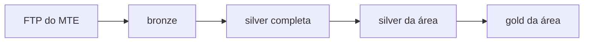

# Mercado de trabalho no Brasil, por área

Pipeline de dados que recorta os microdados públicos da **RAIS** e do
**CAGED** (Ministério do Trabalho e Emprego) por área de atuação — hoje
**TI** (`tec`), **saúde** e **educação** — e publica cada área como dados
abertos no Hugging Face. A área é escolhida ao iniciar o workflow no GitHub
Actions.

Nasceu do TCC *Análise, Visualização e Previsão do Mercado de Tecnologia no
Brasil* (UTFPR), cujo código, dados validados e site continuam no repositório
[mercadotech](https://github.com/GianSE/mercadotech).

## Camadas

| Camada | O que é | Onde |
|---|---|---|
| Bronze | O arquivo do FTP em Parquet, sem tratamento | `Gianpedro/bronze-caged`, `Gianpedro/bronze-rais` |
| Silver completa | A base inteira traduzida pelos dicionários oficiais do MTE | `Gianpedro/silver-caged`, `Gianpedro/silver-rais` |
| Silver da área | O recorte da área, sem nova tradução | `Gianpedro/silver-caged-<área>`, `Gianpedro/silver-rais-<área>` |
| Gold da área | Agregados, cubos do CAGED e resultados dos modelos | `Gianpedro/gold-analise-mercado-<área>` |

A bronze e a silver completa não dependem de área e são as mesmas do
mercadotech. A silver e a gold são recalculadas por área. TI se chama `tec`
aqui porque `silver-caged-ti` e `gold-analise-mercado-ti` são os conjuntos do
TCC, mantidos pelo mercadotech.

## O recorte

Cada área é a união de duas lentes, definidas em
[`tasks-python/_utils/areas.py`](tasks-python/_utils/areas.py):

- **Setor** — quem trabalha num estabelecimento da área, pela subclasse CNAE
  (uma escola, um hospital, uma empresa de software);
- **Ocupação** — quem exerce ocupação da área em qualquer setor, pela família
  CBO (o professor de uma empresa, o enfermeiro de uma indústria).

O recorte é por código, nunca por palavra-chave na descrição. As listas de TI
foram validadas no TCC; as de saúde e educação ainda precisam da mesma
verificação (o peso de cada família e o que ela arrasta de carona) antes de
os números serem usados.

Para acrescentar uma área: um bloco novo em `areas.py` e a opção nova nos
inputs `area` dos workflows.

## Como rodar

No GitHub Actions, **Pipeline por área (orquestrador)** com a área e a camada
de onde começar. Cada etapa também roda sozinha, com o mesmo input de área.
Segredos usados: `HF_TOKEN` (escrita nos datasets) e, opcionais,
`TELEGRAM_BOT_TOKEN` e `TELEGRAM_CHAT_ID` para avisos.

Para rodar local, copie `.env.example` para `.env` e instale
`requirements-pipeline.txt`.

## Site

`dashboards/` é o site do TCC, em refatoração para ler qualquer área. Ele não
é publicado a partir deste repositório.
