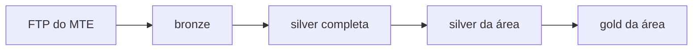

# Mercado de trabalho no Brasil, por área

Pipeline de dados que recorta os microdados públicos da **RAIS** e do
**CAGED** (Ministério do Trabalho e Emprego) por área de atuação — hoje nove:
**TI** (`tec`), **saúde**, **educação**, **agronegócio**, **finanças**,
**indústria e manufatura**, **construção civil**, **logística e transporte** e
**comércio** — e publica cada área como dados abertos no Hugging Face. A área
é escolhida ao iniciar o workflow no GitHub Actions.

Nasceu do TCC *Análise, Visualização e Previsão do Mercado de Tecnologia no
Brasil* (UTFPR), cujo código, dados validados e site continuam no repositório
[mercadotech](https://github.com/GianSE/mercadotech).

## Camadas



| Camada | O que é | Onde |
|---|---|---|
| Bronze | O arquivo do FTP em Parquet, sem tratamento | `Gianpedro/bronze-caged`, `Gianpedro/bronze-rais` |
| Silver completa | A base inteira traduzida pelos dicionários oficiais do MTE | `Gianpedro/silver-caged`, `Gianpedro/silver-rais` |
| Silver da área | O recorte da área, sem nova tradução | `Gianpedro/mercadobrasil-<área>`, pastas `silver-caged-<área>/` e `silver-rais-<área>/` |
| Gold da área | Agregados, cubos do CAGED e resultados dos modelos | `Gianpedro/mercadobrasil-<área>`, pasta `gold-<área>/` |

A bronze e a silver completa não dependem de área e são as mesmas do
mercadotech. A silver e a gold são recalculadas por área. TI se chama `tec`
aqui porque `silver-caged-ti` e `gold-analise-mercado-ti` são os conjuntos do
TCC, mantidos pelo mercadotech.

## O recorte

Cada área é a união de duas lentes, definidas em
[`tasks-python/_utils/areas.py`](tasks-python/_utils/areas.py):

- **Setor** — quem trabalha num estabelecimento da área, pela subclasse CNAE
  (uma escola, um hospital, uma empresa de software);
- **Ocupação** — quem exerce ocupação da área em qualquer setor, pela família
  CBO (o professor de uma empresa, o enfermeiro de uma indústria).

O recorte é por código, nunca por palavra-chave na descrição. As listas de TI
foram validadas no TCC; as das outras áreas ainda precisam da mesma
verificação (o peso de cada família e o que ela arrasta de carona) antes de
os números serem usados.

Para acrescentar uma área: um bloco novo em `areas.py` e a opção nova nos
inputs `area` dos workflows.

## Como rodar

No GitHub Actions, a lista de workflows se agrupa pelo nome:

| Workflow | Quando | Para quê |
|---|---|---|
| **1 · CAGED (semanal)** | sozinho, toda terça | o mês novo do CAGED em todas as áreas: silver da área, gold do CAGED (ano corrente e anterior), o fluxo do mapa, previsão e nowcast |
| **2 · RAIS (mensal)** | sozinho, todo dia 15 | o ano novo da RAIS em todas as áreas: silver da área, gold da RAIS, o estoque do mapa, hiato e sobrevivência |
| **Alerta · Dicionário MTE** | sozinho, todo dia 1 | avisa se o MTE publicou dicionário novo |
| **Auditoria · ...** | à mão | confere a silver da área contra a contagem direto na bronze |
| **Etapa · ...** | à mão, raramente | uma etapa solta, para consertar algo pontual (refazer a silver de um ano, por exemplo) |
| **Novo · Carga inicial de uma área (CAGED + RAIS)** | à mão | montar uma área nova ou refazer uma área inteira, as duas bases num clique |
| **Uso interno · ...** | nunca | peças que o 1 e o 2 chamam para cada área; não têm botão de rodar |

Nas filas 1 e 2, sem dado novo cada etapa verifica e para, sem rodar a gold.
O mapa é a junção de uma parte de cada base: cada fila refaz a sua e
reaproveita a outra publicada.
Segredos usados: `HF_TOKEN` (escrita nos datasets) e, opcionais,
`TELEGRAM_BOT_TOKEN` e `TELEGRAM_CHAT_ID` para avisos.

Para rodar local, copie `.env.example` para `.env` e instale
`requirements-pipeline.txt`.

## Site

`site/` é o painel novo (React, Tailwind e componentes no padrão shadcn/ui,
gráficos em ECharts). A página inicial lista as áreas, e cada área tem a sua
página. Os dados não entram no build: o site lê as tabelas da gold de cada
área direto do Hugging Face, quando a página pede. Uma tabela que a área ainda
não publicou aparece como aviso, sem quebrar a página.

As áreas vêm de `tasks-python/_utils/areas.py`. Depois de mudar uma área,
regenere a lista que o site lê:

```bash
cd site
npm run areas   # escreve site/src/areas.json
npm run dev
```

O site é publicado como um Cloudflare Worker só de arquivos estáticos
(`site/wrangler.jsonc`), ligado a este repositório pelo Workers Builds:
diretório raiz `site`, build `npm run build`, deploy `npx wrangler deploy`.
Cada push na `main` publica. Para publicar do terminal: `npm run deploy`.

`dashboards/` é o site antigo do TCC, mantido como referência até o novo
cobrir tudo. Ele não é publicado a partir deste repositório.
